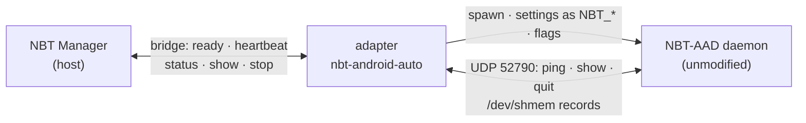

<!-- SPDX-License-Identifier: MPL-2.0 -->
<p align="center">
  <picture>
    <source media="(prefers-color-scheme: dark)" srcset="docs/assets/logo-dark.svg">
    
  </picture>
</p>

<h1 align="center">Android Auto for NBT Manager</h1>

> **Warning: installing or modifying this software can brick your head unit. Recovery may require professional service or replacement, at your expense. Provided AS IS; use at your own risk, subject to applicable law.** [Read the risk and liability disclaimer](DISCLAIMER.md).

[NBT-AAD](https://github.com/Sq00ky/Supra-iDrive6-Android-Auto), native
Android Auto for BMW NBT Evo (iDrive 6) and the Toyota GR Supra, as an
application of [NBT Manager](https://github.com/NBTFoundry/manager): installed
and updated from the phone, signed, health-checked and rolled back like every
other application, with its settings in the manager.

NBT-AAD is by nanaisu and its contributors. This repository does not change
it: it pins it as a submodule and adds an adapter, an
[SDK](https://github.com/NBTFoundry/sdk) application that starts NBT-AAD's
daemon and stands for it on the manager's bridge.

Not affiliated with or endorsed by BMW AG, Toyota, Google or NBT-AAD's
authors. Android Auto is a trademark of Google LLC.

## Status

**A test build, not for use while driving.** The manager does not yet provide
what NBT-AAD's own iDrive plugin did: stepping aside for the reverse camera,
park assist, warnings and calls, and holding iDrive's focus under Android
Auto. That is bridge 1.6, planned in the manager; see
[docs/upstream-interface.md](docs/upstream-interface.md). Until then NBT-AAD's
own iDrive plugin, left installed, serves the managed daemon too:
[docs/car-test.md](docs/car-test.md) is the test with it. The adapter refuses
to start while another install's daemon runs.



## Build and test

Linux host: gcc, Python 3, and the sibling checkouts `../sdk` and `../manager`.

```sh
git submodule update --init
make test           # protocol check against the pin, unit tests, the adapter with a fake daemon
make test-asan      # the same under AddressSanitizer/UBSan
make test-upstream  # NBT-AAD's own host tests, at the pin
```

Head unit (QNX 6.5 ARMv7; `QNX_SCREEN_LIBDIR` holds `libscreen.so`):

```sh
make QNX_ENV=/path/to/qnx-env.sh QNX_SCREEN_LIBDIR=/path/to/screen/lib qnx qnx-check
make QNX_ENV=... QNX_SCREEN_LIBDIR=... vm-test      # QNX 6.5 SP1 under QEMU (the SDK's VM)
make QNX_ENV=... QNX_SCREEN_LIBDIR=... package APP_KEY=/secure/apps-private.pem APP_SEQ=<n>
```

`qnx` builds the daemon with NBT-AAD's own Makefile and the car's libraries
it carries, then appends it to the adapter: `build/nbt-android-auto-qnx` is
the package's one executable. The package version is the pin's release.

## Settings

`src/settings.def` is the one table: the manager's choices, and the `NBT_*`
variable or flag file each gives the daemon. `make package-args` writes
`release/package.args` from it; `make test` fails when either is stale or
names something the pinned daemon does not have.

## Moving the pin

```sh
git -C third_party/nbt-aad fetch origin && git -C third_party/nbt-aad checkout <tag or seam branch>
make test test-upstream && make QNX_ENV=... QNX_SCREEN_LIBDIR=... qnx-check vm-test
make notice         # when NBT-AAD's notices changed
```

Changes NBT-AAD needs go to it as pull requests from
`NBTFoundry/Supra-iDrive6-Android-Auto`; the pin follows that branch until
upstream merges it.

## License

Copyright (c) 2026 Fabien Poussin. This repository's original code, tests,
build scripts and documentation are licensed under **MPL-2.0**; see
[LICENSE](LICENSE).

NBT-AAD is licensed under the **PolyForm Noncommercial License 1.0.0**
([LICENSES/PolyForm-Noncommercial-1.0.0.txt](LICENSES/PolyForm-Noncommercial-1.0.0.txt)).
The package contains it, so the package is for noncommercial use only and
carries its Required Notice:

Required Notice: Copyright (c) 2026 nanaisu - NBT-AAD (https://github.com/Sq00ky/Supra-iDrive6-Android-Auto)

See [legal/README.md](legal/README.md) for all notices.
