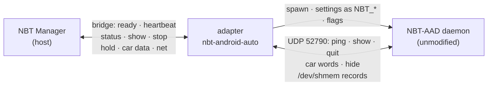

<!-- SPDX-License-Identifier: MPL-2.0 -->
<p align="center">
  <picture>
    <source media="(prefers-color-scheme: dark)" srcset="docs/assets/logo-dark.svg">
    
  </picture>
</p>

<h1 align="center">Android Auto for NBT Manager</h1>

> **Warning: installing or modifying this software can brick your head unit. Recovery may require professional service or replacement, at your expense. Provided AS IS; use at your own risk, subject to applicable law.** [Read the risk and liability disclaimer](DISCLAIMER.md).

[NBT-AAD](https://github.com/Sq00ky/Supra-iDrive6-Android-Auto), native
Android Auto for BMW NBT Evo (iDrive 6) and the Toyota GR Supra, as an
application of [NBT Manager](https://github.com/NBTFoundry/manager): installed
and updated from the phone, signed, health-checked and rolled back like every
other application, with its settings in the manager.

NBT-AAD is by nanaisu and its contributors. This repository does not change
it: it pins it as a submodule and adds an adapter, an
[SDK](https://github.com/NBTFoundry/sdk) application that starts NBT-AAD's
daemon and stands for it on the manager's bridge.

Part of [NBTFoundry](https://github.com/NBTFoundry):
[manager](https://github.com/NBTFoundry/manager) ·
[sdk](https://github.com/NBTFoundry/sdk) ·
[mobile-app](https://github.com/NBTFoundry/mobile-app) ·
[installer](https://github.com/NBTFoundry/installer) ·
[toolchains](https://github.com/NBTFoundry/toolchains)

Not affiliated with or endorsed by BMW AG, BlackBerry Limited, Toyota, Google or
NBT-AAD's authors. QNX is a trademark of BlackBerry Limited; Android Auto is a
trademark of Google LLC.

## Status

**A test build, not for use while driving.** With NBT Manager's bridge 1.6
the adapter does what NBT-AAD's own iDrive plugin did: it holds iDrive's focus
under Android Auto, steps aside for the reverse camera, park assist, camera
views and screens the car opens, keeps Android Auto during calls, feeds the
daemon its car data and has the manager open its port in the packet filter;
see [docs/upstream-interface.md](docs/upstream-interface.md). The package
declares bridge 1.6 and carries what the phone app shows before an install
(the NBT-AAD version, the project, its licence and notice), so it needs NBT
Manager 0.3.1 or later. The car test is [docs/car-test.md](docs/car-test.md). The adapter refuses to start while
another install's daemon runs.



## Build and test

Linux host: gcc, Python 3, and the sibling checkouts `../sdk` and `../manager`.

```sh
git submodule update --init
make test           # protocol check against the pin, unit tests, the adapter with a fake daemon
make test-asan      # the same under AddressSanitizer/UBSan
make test-upstream  # NBT-AAD's own host tests, at the pin
```

Head unit (QNX 6.5 ARMv7), without the QNX SDP: the NBT toolchain's QNX
target builds both programs (the SDK's `docs/native-apps.md`):

```sh
make -C ../sdk toolchain   # once
make qnx qnx-check
make vm-test               # QNX 6.5 SP1 under QEMU (the SDK's VM; needs the SP1 tools locally)
make package APP_KEY=<key> APP_VERSION=<x.y.z> APP_SEQ=<n>
```

`qnx` builds the adapter on the SDK, and the daemon from NBT-AAD's sources as
its Makefile lists them, linked against the car's own libraries (libsocket,
libssl, libcrypto, libscreen, libusbdi, liba2i_client) by name; then appends
the daemon to the adapter: `build/nbt-android-auto-qnx` is the package's one
executable.

## Releases

`.github/workflows/ci.yml` runs the protocol check, the tests, the same under
ASan/UBSan, NBT-AAD's own tests and the head-unit build on every push and pull
request. A `vX.Y.Z` tag runs `.github/workflows/release.yml`: NBT Manager's application
release workflow builds the package with the NBT toolchain (no QNX SDP, no
private image), signs it with the apps
key after approval (the `release` environment, secret `APPS_SIGNING_KEY`, tags
`v*` only) and publishes `android-auto-X.Y.Z.nbt`. The tag is this
repository's own version (the sequence is X·10⁶ + Y·10³ + Z); each release
names the NBT-AAD commit it carries. `release/sdk.ref` is the SDK commit that
both the release and `ci.yml` build against:
[SDK 0.1.0](https://github.com/NBTFoundry/sdk/releases/tag/v0.1.0). A local test package takes
`APP_VERSION` and `APP_SEQ`.

## Settings

`src/settings.def` is the one table: the manager's choices, and the `NBT_*`
variable or flag file each gives the daemon. `make package-args` writes
`release/package.args` from it; `make test` fails when either is stale or
names something the pinned daemon does not have.

## Moving the pin

```sh
git -C third_party/nbt-aad fetch origin && git -C third_party/nbt-aad checkout <tag or seam branch>
make test test-upstream && make qnx-check vm-test
make notice         # when NBT-AAD's notices changed
```

Changes NBT-AAD needs go to it as pull requests from
`NBTFoundry/Supra-iDrive6-Android-Auto`; the pin follows that branch until
upstream merges it.

## License

Copyright (c) 2026 Fabien Poussin. This repository's original code, tests,
build scripts and documentation are licensed under **MPL-2.0**; see
[LICENSE](LICENSE).

NBT-AAD is licensed under the **PolyForm Noncommercial License 1.0.0**
([LICENSES/PolyForm-Noncommercial-1.0.0.txt](LICENSES/PolyForm-Noncommercial-1.0.0.txt)).
The package contains it, so the package is for noncommercial use only and
carries its Required Notice:

Required Notice: Copyright (c) 2026 nanaisu - NBT-AAD (https://github.com/Sq00ky/Supra-iDrive6-Android-Auto)

See [legal/README.md](legal/README.md) for all notices.
